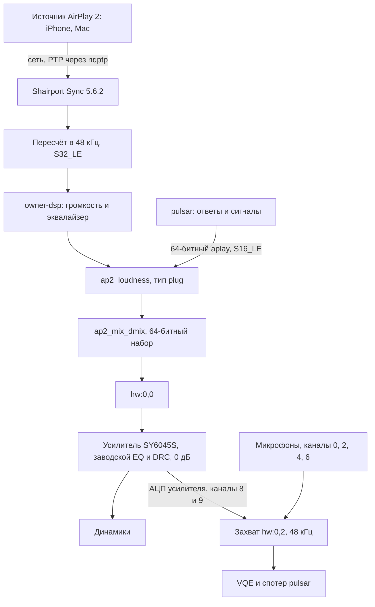

# Пайплайн AirPlay Станции 2

Как звук AirPlay идёт от источника до динамика и как с ним уживается голосовой демон. Приёмник, его патчи, панель
и скрипты запуска это стек владельца, в репозиторий они не входят. Отсюда в репозитории только сторона демона:
`satellite/crates/pulsar/src/airplay.rs` и `satellite/crates/pulsar-media/src/shared_out.rs`. Обработка звука описана в
[эквалайзере](station2-equalizer.md), причины решений в [исследованиях](station2-research.md).

## Цепочка



| Звено | Роль | Почему так |
| --- | --- | --- |
| `nqptp` | Часы PTP для синхронности группы AirPlay | Должен быть один и стартовать раньше приёмника |
| Shairport Sync | Приём AirPlay 2, синхронизация, пересчёт частоты | Собран с `owner-dsp` и своим alsa-lib 1.2.15 под aarch64 musl |
| `output_rate = 48000` | Постоянная частота выхода | Такт захвата равен частоте последнего открытия `hw:0,0`, см. [station2.md](station2.md#такт-захвата-зависит-от-воспроизведения) |
| `ap2_loudness` | Вход общего вывода | Плагин `plug` перед общим dmix |
| `ap2_mix_dmix` | Смешивание музыки и голоса | См. [общий dmix](#общий-dmix-с-airplay) |
| Усилитель | Общая громкость музыки и голоса | `mixer_control_name = "SY6045S Master"`, диапазон 60 дБ, см. [громкость](station2-equalizer.md#громкость) |

Опорный сигнал снимается после всей цифровой обработки, поэтому VQE вычитает и музыку, и ответы.

## Конфигурация

Приёмник, секция `alsa`:

```
output_device = "ap2_loudness";
output_rate = 48000;
output_format = "S32_LE";
audio_backend_buffer_desired_length_in_seconds = 0.5;
disable_standby_mode = "auto";
```

Секция `sessioncontrol`: `active_state_timeout = 0.5` освобождает выход вскоре после паузы, а
`run_this_before_play_begins` забирает выход у других плееров владельца.

`asound.conf` приёмника самодостаточен, без `alsa.conf`, поэтому dmix нужен свой `timer.hw`:

```
timer.hw {
    @args [ CLASS SCLASS CARD DEV SUBDEV ]
    @args.CLASS { type integer }
    @args.SCLASS { type integer }
    @args.CARD { type integer }
    @args.DEV { type integer }
    @args.SUBDEV { type integer }
    type hw
    class $CLASS
    sclass $SCLASS
    card $CARD
    device $DEV
    subdevice $SUBDEV
}
pcm.ap2_mix_dmix {
    type dmix
    ipc_key 2048
    ipc_key_add_uid false
    ipc_perm 0666
    slave {
        pcm { type hw; card 0; device 0 }
        channels 2
        rate 48000
        format S32_LE
        period_size 960
        buffer_size 7680
    }
}
pcm.ap2_loudness { type plug; slave.pcm "ap2_mix_dmix" }
```

Запрошенный буфер 7680 кадров, настоящий буфер устройства 4096.

## Запуск

Всё стартует одним скриптом владельца при загрузке: D-Bus, avahi, `nqptp`, приёмник, распорядитель звука, панель и
супервизор демона. Сеть, rootfs и стек Яндекса демон не трогает. Без демона музыка играет как обычно. Файл
`/data/pulsar/disabled` отключает автозапуск. После падения супервизор поднимает демон через 5 с. Журнал
`/tmp/pulsar.log`.

## AirPlay и голос

Сервис `airplay` существует только на станциях с `/data/local/opt/ap2/touch-action.sh`:

- По wake word музыка сразу глушится строкой `mute=1` в `/run/ap2-dsp`: приёмник смотрит этот файл раз
  в 100 мс и применяет настройки к блоку, а сохранённые настройки и правки панели не теряются. Нужен
  приёмник с параметром `mute`, старый отклонит файл целиком и музыка заглушена не будет.
- Сразу за этим ставится пауза через D-Bus приёмника. Команда `PlayPause` действует на всю группу AirPlay, поэтому
  вторая колонка замолкает от паузы, а не от заглушения. После ответа победившая колонка снимает паузу.
- Следующие три пункта касаются только прямого вывода, без [общего dmix](#общий-dmix-с-airplay).
- Earcon при паузе не играет: выход занят, а сама пауза подтверждает, что станция услышала.
- Ответ ждёт освобождения выхода, максимум 3,5 с. Выход освобождается примерно через 3 с при
  `active_state_timeout = 0.5`.
- После освобождения 0,2 с тишины на 48 кГц возвращают такт захвата. То же после естественного
  окончания AirPlay.

## Арбитраж

Стек владельца режет исходящие на `255.255.255.255` (`OWNER_NET` в `S35owner-network`), подсеть
разрешена, поэтому заявки арбитра уходят на широковещательный адрес подсети. Адрес берётся из
таблицы маршрутов; прежний остаётся запасным. Без арбитража диалог начинают обе колонки, и две
команды `PlayPause` отменяют друг друга: паузу AirPlay должна посылать только победившая.

## Общий dmix с AirPlay

Один dmix на 32-битный демон и 64-битный приёмник не работает: стоковый клиент (alsa-lib 1.2.1) создаёт
dmix, клиент приёмника (alsa-lib 1.2.15) с тем же `ipc_key` получает `unable to create IPC shm instance`.
Причины отказа по отдельности (разрядность, версия) не разделялись.

Поэтому dmix живёт в 64-битном наборе приёмника, а демон выводит звук через его `aplay`. Приёмник
пересчитывает поток в 48 кГц сам (`output_rate`), выход и такт захвата всегда на 48 кГц. Если цепочки
`ap2_mix_dmix` в конфигурации приёмника нет, вывод остаётся прежним, с паузой и ожиданием.

Очередь в `aplay` оценивается по часам, а не по указателю устройства, поэтому оценка конца воспроизведения идёт
с запасом на буферы. Точность этой оценки не мерилась. Другие каналы, которым нужен свой выход (потоки
из HA через GStreamer, Sendspin), на общий dmix не переведены и под AirPlay не проверены.

Диалог под AirPlay, из журнала:

| Событие | От wake word |
| --- | --- |
| Сигнал подтверждения и заглушение | 0,25 с |
| Началась речь по VAD | 1,45 с |
| Выход свободен (уже ни на что не влияет) | 3,23 с |
| Конец речи | 3,42 с |
| Ответ начал играть | 4,12 с |

Ответ теперь ограничен длиной фразы и распознаванием. Владелец подтвердил, что сигнал активации слышен под музыкой.

Рассинхрон с Red по опорным сигналам и NTP при обычном выводе на Red: 3,06 мс, через 6 минут 1,81 мс. Погрешность часов
оценочно до нескольких миллисекунд, компенсация задержки не понадобилась. Замер с dmix на обеих колонках ещё не сделан.

## Как шли к этому: прямой вывод

Демон запущен вручную, HA 2026.10.4, GigaAM и синтез через мост Wyoming, агент разговора встроенный.
Под настоящим AirPlay, по журналу демона, один диалог:

| Событие | От wake word |
| --- | --- |
| Диалог начат (арбитраж 0,25 с) | 0,25 с |
| Выход свободен, такт 48 кГц | 3,68 с |
| Ответ начал играть | 5,28 с |
| Ответ сыгран, AirPlay возобновлён | 8,27 с |

Всего три диалога: «Который час» распознано дважды, один раз «Какой час?». Выборка мала, условия
записи разных диалогов не разделялись.

С `mute`, уровень AirPlay −43,6 дБ, ниже прежнего ограничения в −36 дБ, один диалог из журнала:

| Событие | От wake word |
| --- | --- |
| Команда заглушения | 0,25 с |
| Началась речь по VAD | 1,62 с |
| Выход свободен, такт 48 кГц | 3,68 с |
| Ответ начал играть | 3,74 с |

По словам владельца, Blue замолкает после «Яндекс», затем по паузе останавливается Red, после ответа
музыка продолжается. Время до акустической тишины не мерилось. В соседнем диалоге ответ был готов раньше
и ждал освобождения выхода до 3,3 с, поэтому 3,68 с остаётся нижней границей ответа при прямом выводе.

## Не проверено

- Диалог под AirPlay с демонами на двух колонках, настоящий голос через арбитраж.
- Рассинхрон при dmix на обеих, долгое прослушивание на dmix.
- Громкая музыка, пауза дольше 15 с.
- Источник на Mac в рассинхроне: сдвиг мог быть особенностью источника.
